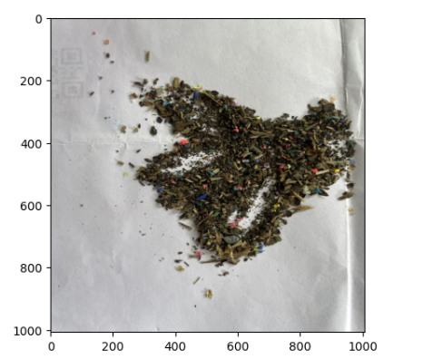
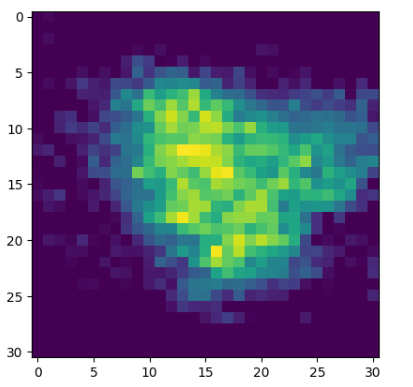
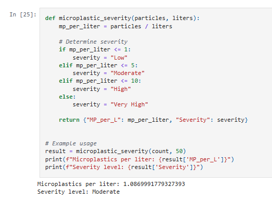

# Model Training

## About the model

This project uses **CSRNet**, a deep learning model that takes a microscope image and estimates how many microplastic particles are in it. It does this by producing a "density map" (a heatmap of where particles are), then adding it up to get a count.

## Dataset

The images were split into three sets:

| Set        | Images | Purpose |
|------------|--------|---------|
| Training   | 335    | The model learns from these |
| Validation | 130    | Checked after each epoch to track progress on unseen data |
| Test       | 35     | Used only once at the end for the final score |

**Total: 500 images** (about 67% training, 26% validation, 7% test)

## Example detection using the trained model
### Example microplastic sample

- This is a photo of a sample placed on white cloth. The small colorful fragments mixed in with the debris are the microplastics the model needs to find and count. They are hard to count by eye because they are tiny, scattered, and overlap with other material.

### Example density map

- The model turns the image into a **density map**, a heatmap showing where it thinks the particles are.
    - **Bright areas (yellow/green)**: many particles are likely here.
    - **Dark areas (purple)**: few or no particles.
- The bright area matches the pile in the photo, which shows the model is looking at the right place. Adding up all the values in the map gives the **estimated particle count**.

### Example prediction results

- The predicted count is then converted into a pollution level. In this example, the sample is treated as 50 liters of water:
    - Microplastics per liter = particle count ÷ liters
    - The result is **about 1.09 particles per liter**, which is labeled **Moderate**
  
| Particles per liter | Severity |
|---------------------|----------|
| 1 or less           | Low |
| More than 1 up to 5 | Moderate |
| More than 5 up to 10 | High |
| More than 10        | Very High |

> These severity levels are thresholds I defined for this project. They are not an official scientific standard.

# Training curve after training the model

### What these charts show

I trained the model for 30 rounds (called epochs). After each round, I checked how well it was doing.

- **Loss** (left chart): how wrong the model is. Lower is better.
- **MAE** (right chart): the average size of the model's mistakes. Lower is better.
- **Blue line**: how the model does on data it learned from.
- **Red line**: how the model does on new data it has never seen.

### Results

| Metric | Training | Validation |
|--------|----------|------------|
| Loss   | ~0.0016  | ~0.0030    |
| MAE    | ~0.024   | ~0.034     |

On a separate test set, the model's average error was **X particles per image** (MAE) with a counting accuracy of **XX%**.

### What this means

Both lines go down, which means the model is learning to detect microplastics. The red line is a bit higher than the blue line, which is normal: the model is slightly better on data it has already seen than on new data. Validation stopped improving after about epoch 20, so training longer would not help much.

### Possible improvements

- Add more training images
- Use data augmentation (flips, rotations, brightness changes)
- Try early stopping around epoch 20

# Setup instructions

1. Must have python interpreter :
    - [Download python](https://www.python.org/downloads/)

2. Create your own folder in your local machine

3. Install *Jupyter notebook* in your local machine, open cmd or terminal and type:
   
   - `pip install notebook`
    
4. After installation of *Jupyter notebook*, open created folder and navigate to its directory in the terminal, create a *venv* or virtual environment, this will be the container of your libraries:

   >Create venv in that folder created
   - `python -m venv {your own name of venv}`
   >Then activate the venv
   - `venv\Scripts\activate`
   >to deactivate
   - `venv\Scripts\deactivate`
   >when activated it will look like this as an example
   - `(venv) C:\Users\[user]\Desktop\microplastics-detection>`

5. Now use the *requirements.txt* to install all libraries required to run the program or code.
   
   >**"REMEMBER KEEP THE VENV ACTIVATED"**

   >paste this once the venv is activated
   - `pip install -r requirements.txt`
   >check if they are installed
   - `pip list`

6. Basically *Jupyter notebook* uses kernels to run its code. So, we already did that by installing it using *requirements.txt*. 

   In order to use our created venv with installed required libraries we will need to use the *ipykernel* (installed already, listed also in the txt file) library to configure the kernel to be used in the notebook.

    **"RECOMMENDED TO PASTE THIS COMMANDS IN THE ACTIVATED VENV"**

      >create your kernel using the venv you created
      - `python -m ipykernel install --user --name=myenv --display-name "Python (myenv)"`
   
   - `--name` : internal kernel name
   - `--display-name` : the name you’ll see inside Jupyter Notebook
   >to check if the kernel is now existing
   - `jupyter kernelspec list`
   > This is optional only if something happened etc. this is how you deleted the kernel
   - `jupyter kernelspec remove [the name of --name kernel setupn from the kernel list]`

7. Now, in the same terminal or cmd where the venv is activated *(It does not matter if it's activated or not as long your terminal is navigated in that folder)* 
     
     >Now type this, this will open the *Jupyter notebook*
     - `jupyter notebook`

8. To change the kernel, after opening the notebook on the top bottom click the *Kernel* then again click the *Change Kernel*

